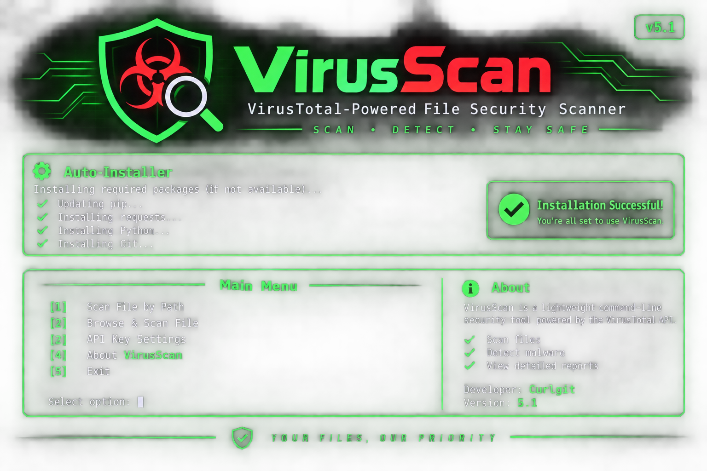

<div align="center">



# VirusScan

### VirusTotal-Powered File Security Scanner

**SCAN • DETECT • STAY SAFE**

Version 5.1

**Developer: KSURitam and Anshaks**

</div>

---

## About

VirusScan is a lightweight command-line security scanner designed for Android and Termux. Powered by the VirusTotal API, it helps users analyze files, identify potential malware, check SHA-256 hashes, and review results from multiple antivirus engines through a clean, color-coded interface.

## Creditd
- **Developer:** **KSURitam and Anshaks**
- **API KEY:** **VirusTotal**
-  
Special thanks to the VirusTotal team for providing the threat intelligence API.

## Get Your API Key

1. Visit **https://www.virustotal.com**
2. Create an account and log in.
3. Open **My Account**.
4. Open link find key **https://www.virustotal.com/gui/my-apikey**
5. Copy your API key.
6. Enter it when VirusScan launches.

## Installation

Run this command in Termux:

```bash
curl -fsSL https://raw.githubusercontent.com/KSURitam/VirusScan/main/virusscan.py -o virusscan.py && curl -fsSL https://raw.githubusercontent.com/KSURitam/VirusScan/main/install.sh -o install.sh && bash install.sh && python virusscan.py
```

## Features

- SHA-256 File Hashing
- VirusTotal Database Lookup
- File Upload & Analysis
- Multiple Antivirus Engine Reports
- Malware Detection Results
- Color-Coded Security Verdicts
- Termux Storage Browser
- Local API Key Storage

## Requirements

- Android / Termux
- Internet Connection
- VirusTotal API Key

Developed with care by **KSURitam**


## Disclaimer

**VirusScan is an independent project developed by KSURitam and is not officially affiliated with, endorsed by, or sponsored by VirusTotal**

**This tool uses the VirusTotal API to retrieve file analysis reports. Detection results are provided for informational purposes only**

**A clean scan does not guarantee that a file is safe.
Uploaded files may be shared with VirusTotal security partners.
Users are responsible for the files they choose to upload.
Never upload confidential or sensitive files without understanding the privacy implications.
The developer is not responsible for misuse, data loss, or damages resulting from the use of this tool**

**Use VirusScan responsibly and at your own risk**
